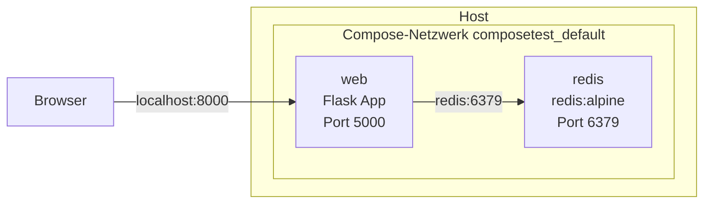

# Auftrag 4.2: Container Orchestration mit Docker Compose

Ziel: das offizielle Docker Compose Tutorial analysieren und das Wissen auf die eigene Webseite aus Auftrag 3.4 übertragen.

## Struktur

```
aufgabe4_2/
  composetest/          Tutorial (Flask + Redis)
    app.py
    requirements.txt
    Dockerfile
    compose.yaml
  web/                  eigene Webseite aus 3.4
    app/web/index.html
    dockerfiles/Dockerfile.web
    docker-compose.yml
```

# Teil 1: Analyse Docker Compose Tutorial

Tutorial: https://docs.docker.com/compose/gettingstarted/

```bash
cd aufgabe4_2/composetest
docker compose up --build
```

Unter http://localhost:8000 erscheint `Hello World! I have been seen 1 times.`, bei jedem Reload zählt die Zahl hoch.

## Diagramm der Architektur



```
Browser
   |  http://localhost:8000
   v
+------------------- Host -------------------+
|   8000 -> 5000                              |
|  +-----------+   redis:6379  +-----------+  |
|  |    web    | ------------> |   redis   |  |
|  | Flask App |               |  Zähler   |  |
|  +-----------+               +-----------+  |
|        Netzwerk: composetest_default        |
+---------------------------------------------+
```

## Aufgaben der einzelnen Container

- **web**
  - Eigenes Image, wird mit `build: .` aus dem `Dockerfile` gebaut (python:3.10-alpine + Flask)
  - Nimmt die HTTP-Anfragen vom Browser an
  - Erhöht bei jedem Aufruf den Zähler `hits` in Redis und gibt die Anzahl zurück
  - Erreicht Redis über den Servicenamen `redis` (DNS im Compose-Netzwerk), nicht über eine IP
- **redis**
  - Fertiges Image `redis:alpine` von Docker Hub, kein eigenes Dockerfile
  - Speichert den Besucherzähler im Arbeitsspeicher
  - Ist nur intern erreichbar, kein Port auf dem Host freigegeben
- Compose erstellt automatisch ein gemeinsames Netzwerk, damit die beiden Container miteinander reden können

## Was ist Redis?

- Redis = **Re**mote **Di**ctionary **S**erver
- Open Source In-Memory Datenbank, speichert Daten als Key-Value-Paare im RAM
- Dadurch sehr schnell
- Typische Einsätze: Cache, Session-Speicher, Zähler, Message Queue (Pub/Sub)
- Im Tutorial: speichert den Key `hits`, der mit `cache.incr('hits')` um 1 erhöht wird
- Ohne Volume gehen die Daten verloren, wenn der Container gelöscht wird

## Welche Ports werden in diesem Szenario genutzt und warum?

| Port | Wo | Warum |
|------|----|-------|
| **8000** | Host | Port, den man im Browser aufruft (`localhost:8000`) |
| **5000** | Container web | Standardport von Flask, `ports: "8000:5000"` leitet Host 8000 auf Container 5000 weiter |
| **6379** | Container redis | Standardport von Redis, nur im internen Compose-Netzwerk, `web` verbindet sich mit `redis:6379` |

- Schreibweise `HOST:CONTAINER`, also links der Port auf dem eigenen PC, rechts der Port im Container
- Redis braucht kein Port-Mapping, weil nur der `web` Container darauf zugreift und nicht der Browser
- `EXPOSE 5000` im Dockerfile ist nur Dokumentation, freigegeben wird der Port erst durch `ports` im Compose-File

## Was ist die Bedeutung von ENV im Dockerfile?

- `ENV` setzt eine **Umgebungsvariable** im Image
- Sie gilt beim Build (für die nächsten Befehle) und später im laufenden Container
- Im Tutorial:
  - `ENV FLASK_APP=app.py` sagt dem Befehl `flask run`, welche Datei die App ist
  - `ENV FLASK_RUN_HOST=0.0.0.0` lässt Flask auf allen Interfaces lauschen. Standard wäre `127.0.0.1`, dann wäre die App nur im Container selbst erreichbar und nicht von aussen
- Kann beim Start überschrieben werden, z.B. mit `docker run -e` oder `environment:` im Compose-File
- Vorteil: Konfiguration ist vom Code getrennt (wie beim 12-Factor Prinzip "Config")

```dockerfile
FROM python:3.10-alpine
WORKDIR /code
ENV FLASK_APP=app.py
ENV FLASK_RUN_HOST=0.0.0.0
RUN apk add --no-cache gcc musl-dev linux-headers
COPY requirements.txt requirements.txt
RUN pip install -r requirements.txt
EXPOSE 5000
COPY . .
CMD ["flask", "run", "--debug"]
```

# Teil 2: Eigene Anwendung (Transfer aus Auftrag 3.4)

## Docker-Compose-File für die HTML-Webseite

```yaml
services:
  web:
    build:
      context: .
      dockerfile: dockerfiles/Dockerfile.web
    image: mein-webserver
    container_name: m210-web
    ports:
      - "8080:80"
    restart: unless-stopped
```

- `build` baut das Image aus dem Dockerfile von 3.4 (`nginx:alpine` + `COPY app/web`)
- `image` gibt dem gebauten Image einen Namen
- `ports: "8080:80"` Host 8080 auf Port 80 im Container (Standardport von Nginx)
- `restart: unless-stopped` startet den Container nach einem Absturz oder Neustart von Docker automatisch wieder

## Starten und im Browser testen

```bash
cd aufgabe4_2/web
docker compose up -d --build
docker compose ps
```

- Aufruf unter http://localhost:8080 zeigt "Hallo von Elyes"
- Stoppen und aufräumen:

```bash
docker compose down
```

## Welches Image eignet sich für eine statische HTML-Seite?

- **nginx:alpine**
  - Schneller, leichter Webserver, ideal für statische Dateien
  - Alpine Variante ist sehr klein (ca. 50 MB) und hat weniger Schwachstellen (siehe Scout in 3.5)
  - Liefert automatisch alles aus `/usr/share/nginx/html` aus
- **httpd** (Apache) würde auch funktionieren, ist aber grösser und für eine einfache Seite nicht nötig

## Wie müssen die Ports gemappt werden?

- Nginx lauscht im Container auf Port **80**
- Mit `ports: "8080:80"` wird Port 8080 vom Host auf Port 80 im Container weitergeleitet
- Man könnte auch `"80:80"` nehmen, dann reicht `http://localhost`, aber Port 80 ist auf dem Host oft schon belegt

## Unterschied zu docker run

| docker run (3.4) | docker compose (4.2) |
|------------------|----------------------|
| Lange Befehle mit `-p`, `-v`, `--name` | Alles steht im YAML-File |
| Jeder Container einzeln starten | `docker compose up` startet alle Services |
| Netzwerk von Hand erstellen | Gemeinsames Netzwerk wird automatisch erstellt |
| Schwer nachvollziehbar | File ist versionierbar im Git |
