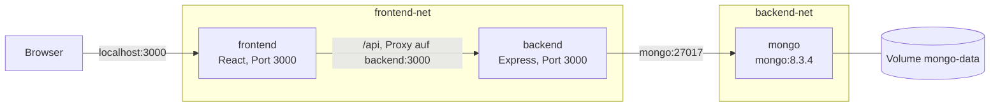

# Auftrag 4.3: Full-Stack-Setup mit Docker Compose

Ziel: das Repository [modul-i-ch-109/docker-compose-sample](https://github.com/modul-i-ch-109/docker-compose-sample) mit einer `compose.yaml` erweitern, die Frontend, Backend und Datenbank zusammen startet.

## Struktur

```
aufgabe4_3/
  frontend/      React App (Todo-Liste), eigenes Dockerfile
  backend/       Node.js / Express API, eigenes Dockerfile
  compose.yaml   neu erstellt
```

## Architektur



```
Browser --3000--> [frontend] --frontend-net--> [backend] --backend-net--> [mongo] --> Volume mongo-data
```

- Das Backend ist in **beiden** Netzwerken, es ist die Brücke zwischen Frontend und Datenbank
- Das Frontend kann die Datenbank **nicht** erreichen, weil es nicht im `backend-net` ist
- Nur das Frontend hat einen Port auf dem Host, Backend und MongoDB sind nur intern erreichbar

## compose.yaml

```yaml
services:
  frontend:
    build:
      context: frontend
      target: development
    container_name: frontend
    ports:
      - "3000:3000"
    networks:
      - frontend-net
    depends_on:
      - backend
    restart: always

  backend:
    build:
      context: backend
      target: development
    container_name: backend
    environment:
      - MONGODB_URI=mongodb://mongo:27017/TodoApp
    networks:
      - frontend-net
      - backend-net
    depends_on:
      - mongo
    restart: always

  mongo:
    image: mongo:8.3.4
    container_name: mongo
    volumes:
      - mongo-data:/data/db
    networks:
      - backend-net
    restart: always

networks:
  frontend-net:
  backend-net:

volumes:
  mongo-data:
```

## Erklärung der Services

### MongoDB

- `image: mongo:8.3.4` fertiges Image von Docker Hub, kein eigenes Dockerfile
- `volumes: mongo-data:/data/db` speichert die Datenbank in einem Docker Volume, `/data/db` ist der Ordner, in dem MongoDB seine Daten ablegt
- Nur im `backend-net`, damit nur das Backend darauf zugreifen kann
- Kein `ports`, die Datenbank ist von aussen nicht erreichbar (sicherer)

### Backend

- `build: context: backend` baut das Image aus dem vorhandenen `backend/Dockerfile`
- `target: development` nimmt nur die erste Stage im Dockerfile. Die zweite Stage `dev-envs` ist nur für VS Code Dev Environments und installiert unnötig Git und Docker Tools
- `MONGODB_URI=mongodb://mongo:27017/TodoApp` sagt dem Backend, wo die Datenbank ist. `mongo` ist der Servicename, Docker löst ihn per DNS zur IP vom Container auf
- In `frontend-net` und `backend-net`, damit es mit beiden Seiten reden kann
- `depends_on: mongo` startet MongoDB zuerst

### Frontend

- `build: context: frontend` baut das Image aus dem vorhandenen `frontend/Dockerfile`
- `ports: "3000:3000"` einziger Port, der auf dem Host freigegeben ist
- In der `package.json` steht `"proxy": "http://backend:3000"`. Darum muss der Service **genau `backend`** heissen, sonst findet das Frontend die API nicht
- Nur im `frontend-net`

### Netzwerke und Volume

- `frontend-net` und `backend-net` sind eigene Bridge-Netzwerke, die Compose automatisch erstellt
- Vorteil: die Services sind isoliert, jeder sieht nur, was er braucht (Prinzip der minimalen Rechte)
- `mongo-data` ist ein Named Volume, es wird von Docker verwaltet und bleibt nach `docker compose down` erhalten

## Starten

```bash
cd aufgabe4_3
docker compose up -d --build
docker compose ps
```

- Der erste Build dauert ein paar Minuten (npm ci im Frontend)
- Danach im Browser http://localhost:3000 öffnen, die Todo-Liste erscheint

## Test der Verbindungen

### Frontend zu Backend zu Datenbank

- Im Browser ein Todo hinzufügen, es erscheint in der Liste
- Das Backend-Log zeigt die Verbindung zur Datenbank:

```bash
docker compose logs backend
```

```
MongoDB is connected
Server is up on port 3000
```

- Über die API getestet (geht über den Proxy vom Frontend zum Backend):

```bash
curl -X POST -H "Content-Type: application/json" -d '{"text":"Test von Elyes"}' http://localhost:3000/api/todos
curl http://localhost:3000/api
```

```json
{"code":200,"success":true,"message":"Successfully completed","data":[{"_id":"6aec5453369abded3510439a","text":"Test von Elyes"}]}
```

### Isolation der Netzwerke

```bash
docker exec frontend getent hosts mongo    # keine Ausgabe, Frontend sieht MongoDB nicht
docker exec backend getent hosts mongo     # 172.28.0.2  mongo
```

### Persistenz

```bash
docker compose down
docker volume ls          # Volume aufgabe4_3_mongo-data ist noch da
docker compose up -d
curl http://localhost:3000/api
```

- Das Todo "Test von Elyes" ist nach `down` und `up` immer noch da, weil die Daten im Volume liegen und nicht im Container
- Erst `docker compose down -v` löscht auch das Volume und damit alle Daten

## Aufräumen

```bash
docker compose down        # Container und Netzwerke weg, Daten bleiben
docker compose down -v     # zusätzlich Volume löschen
```
