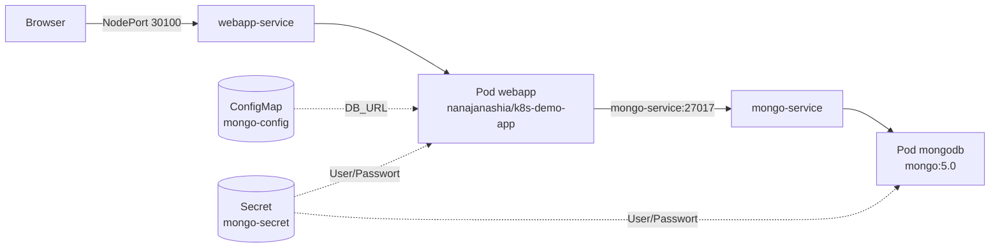

# Auftrag 4.5: Kubernetes mit minikube (Crash Kurs)

Ziel: eine Webapplikation mit Datenbank in einem lokalen Kubernetes-Cluster deployen. Vorlage: [Kubernetes Crash Course](https://www.youtube.com/watch?v=s_o8dwzRlu4) von TechWorld with Nana, Repo [k8s-in-1-hour](https://gitlab.com/nanuchi/k8s-in-1-hour).

## Struktur

```
aufgabe4_5/
  mongo-config.yaml   ConfigMap: Adresse der Datenbank
  mongo-secret.yaml   Secret: Benutzer und Passwort
  mongo.yaml          Deployment + Service für MongoDB
  webapp.yaml         Deployment + Service für die Webapp
```

Die gleichen vier Dateien liegen auch im privaten Repository `dev_minikube`.

## Architektur



## Vorbereitung

```bash
minikube start --driver=docker
mkdir ~/dev_minikube && cd ~/dev_minikube
git init
# die vier YAML-Dateien hier ablegen
git add .
git commit -m "kubernetes config"
git remote add origin https://github.com/elyesghazel/dev_minikube.git
git push -u origin main
```

## Die vier Dateien

### mongo-config.yaml (ConfigMap)

```yaml
apiVersion: v1
kind: ConfigMap
metadata:
  name: mongo-config
data:
  mongo-url: mongo-service
```

- Normale Konfiguration, die nicht geheim ist
- `mongo-url: mongo-service` ist der Name vom Service der Datenbank, die Webapp findet MongoDB darüber per DNS

### mongo-secret.yaml (Secret)

```yaml
apiVersion: v1
kind: Secret
metadata:
  name: mongo-secret
type: Opaque
data:
  mongo-user: bW9uZ291c2Vy
  mongo-password: bW9uZ29wYXNzd29yZA==
```

- Für Zugangsdaten
- Die Werte sind nur **base64-codiert, nicht verschlüsselt**:

```bash
echo bW9uZ291c2Vy | base64 -d        # mongouser
echo bW9uZ29wYXNzd29yZA== | base64 -d   # mongopassword
```

- Eigene Werte erstellen mit `echo -n mongouser | base64`
- Darum gehört ein echtes Secret nie ins Git

### mongo.yaml (Deployment + Service)

- **Deployment** `mongo-deployment`: 1 Pod mit dem Image `mongo:5.0`, Port 27017
- Benutzer und Passwort kommen als Umgebungsvariablen aus dem Secret (`secretKeyRef`)
- **Service** `mongo-service`: interner Service (Standardtyp ClusterIP), nur im Cluster erreichbar
- Der Service findet den Pod über das Label `app: mongo` (`selector`)

### webapp.yaml (Deployment + Service)

- **Deployment** `webapp-deployment`: 1 Pod mit dem Image `nanajanashia/k8s-demo-app:v1.0`, Port 3000
- Bekommt `USER_NAME` und `USER_PWD` aus dem Secret und `DB_URL` aus der ConfigMap (`configMapKeyRef`)
- **Service** `webapp-service` vom Typ **NodePort**: von aussen erreichbar über Port `30100` auf dem Node

### Die 4 Pflichtfelder

| Feld | Bedeutung |
|------|-----------|
| `apiVersion` | Version der Kubernetes API, z.B. `v1` oder `apps/v1` |
| `kind` | Typ: ConfigMap, Secret, Deployment, Service |
| `metadata` | Name und Labels |
| `spec` | Soll-Zustand (bei ConfigMap und Secret heisst es `data`) |

## Deployment

```bash
kubectl apply -f mongo-config.yaml
kubectl apply -f mongo-secret.yaml
kubectl apply -f mongo.yaml
kubectl apply -f webapp.yaml
```

- ConfigMap und Secret zuerst, weil die Pods sie beim Start brauchen
- Sonst bleiben die Pods im Status `CreateContainerConfigError`

## Kontrolle

```bash
kubectl get all
kubectl get configmap
kubectl get secret
kubectl get pods -w
kubectl logs deployment/webapp-deployment
kubectl describe service webapp-service
```

- Beide Pods (mongo und webapp) müssen `Running` und `1/1` sein
- Der erste Start dauert etwas, weil die Images heruntergeladen werden

## Zugriff auf die App

```bash
minikube service webapp-service
```

- Mit dem Docker-Treiber im WSL öffnet minikube einen Tunnel und zeigt eine URL wie `http://127.0.0.1:xxxxx`
- Das Terminal muss offen bleiben, solange man die App braucht
- Ohne Tunnel wäre die Adresse `http://<minikube ip>:30100`

## Dashboard

```bash
minikube dashboard --url
```

- Zeigt die Deployments, Pods, Services, ConfigMaps und Secrets grafisch an
- Unter Workloads sieht man die zwei Deployments, unter Config and Storage die ConfigMap und das Secret

## Selbstheilung testen

```bash
kubectl get pods
kubectl delete pod <name-vom-webapp-pod>
kubectl get pods
```

- Das Deployment merkt, dass Ist (0 Pods) nicht gleich Soll (1 Pod) ist und startet sofort einen neuen Pod mit neuem Namen

## Aufräumen

```bash
kubectl delete -f webapp.yaml
kubectl delete -f mongo.yaml
kubectl delete -f mongo-secret.yaml
kubectl delete -f mongo-config.yaml
minikube stop
```

## Erkenntnisse

- Alles wird **deklarativ** in YAML beschrieben und mit `kubectl apply` an den Cluster gegeben
- Die Konfiguration liegt im Git, damit kann man den gleichen Stand jederzeit wieder deployen
- Pods finden sich über **Services** und deren Namen, nicht über IP-Adressen (Pods bekommen bei jedem Neustart eine neue IP)
- **ConfigMap** für normale Werte, **Secret** für Zugangsdaten
- **ClusterIP** = nur intern (Datenbank), **NodePort** = von aussen erreichbar (Webapp)
